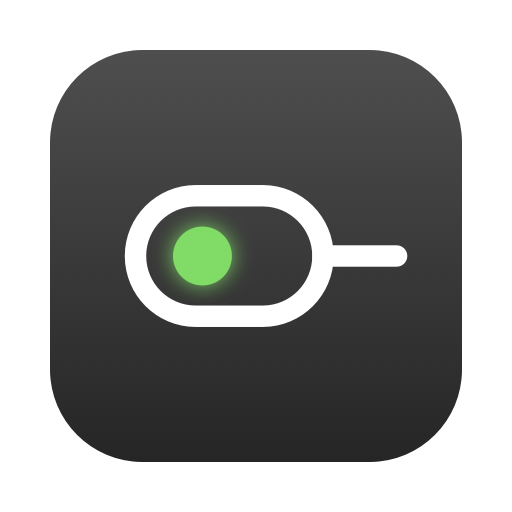

<p align="center">
  
</p>

# MagGlow

Mantén tu Mac despierto con la tapa cerrada y sabe de un vistazo que sigue
trabajando: **el LED del cargador MagSafe parpadea mientras el Mac está activo
con la pantalla apagada.**

Pensado para dejar el portátil cerrado mientras un agente (Claude Code, un
build largo, una descarga…) sigue trabajando, sin dudar de si se ha dormido.

## Qué hace

- **Enchufado a la corriente:** el Mac no se suspende nunca, ni con la tapa
  cerrada.
- **Con batería:** se suspende como siempre, pero desde la barra de menús
  puedes pedirle que aguante con la tapa cerrada **15 min, 30 min o 1 h**.
  Al acabar el tiempo (o si cancelas) y con la tapa cerrada, se duerme en el
  momento.
- **El LED de MagSafe parpadea en verde** mientras el Mac está despierto con
  la tapa cerrada o la pantalla apagada. El resto del tiempo el LED funciona
  como siempre.
- Icono en la barra de menús: conector con el LED encendido (enchufado),
  apagado (batería) o con los minutos que quedan si hay temporizador.

## Requisitos

- MacBook con Apple Silicon y puerto MagSafe 3 (MacBook Pro / Air de 2021 en
  adelante).
- macOS 14 Sonoma o posterior.
- Un cable MagSafe con LED (los de Apple).

## Instalación

Abre Terminal (⌘-Espacio, escribe «Terminal»), pega esto y pulsa Intro:

```sh
curl -fsSL https://raw.githubusercontent.com/utiiga/MagGlow/main/scripts/install.sh | bash
```

Descarga la última versión, la copia en Aplicaciones, instala el ayudante en
segundo plano (te pedirá tu contraseña de administrador una vez) y abre la
app. Busca el icono del conector en la barra de menús.

### Compilar desde el código

Necesitas las Command Line Tools de Xcode (`xcode-select --install`).

```sh
git clone https://github.com/utiiga/MagGlow.git
cd MagGlow
make install
```

## Desinstalar

```sh
sudo /Applications/MagGlow.app/Contents/Resources/uninstall.sh
```

Detiene el ayudante, devuelve el LED a macOS, vuelve a permitir la
suspensión y borra la app y sus archivos.

## Cómo funciona

MagGlow tiene dos piezas:

- **La app de la barra de menús** (se ejecuta como tu usuario): muestra el
  estado, gestiona el temporizador y avisa cuando la pantalla se apaga. Escribe
  lo que quiere en `/Library/Application Support/MagGlow/request.json`.
- **El ayudante** (`com.magglow.helper`, un daemon de launchd que se ejecuta
  como root): lee esa petición cada medio segundo y
  - bloquea o permite la suspensión con `pmset disablesleep`;
  - hace parpadear el LED escribiendo la clave del SMC `ACLC`
    (`3` verde, `1` apagado, `0` control de macOS).

  Publica su estado en `status.json` para que la app lo muestre.

### ¿Es seguro?

- `ACLC` solo cambia lo que *indica* el LED; no afecta a la carga, al voltaje
  ni a la gestión de la batería.
- Cuando el ayudante se detiene (al desinstalar, al apagar o si falla),
  devuelve el LED a macOS y vuelve a permitir la suspensión, así que el Mac
  nunca se queda sin poder dormirse.
- Antes de que el Mac entre en reposo, el LED vuelve al control de macOS.

**Ojo:** enchufado y con la tapa cerrada, el Mac no se suspende. No lo metas
en una funda o mochila en ese estado: puede calentarse.

## Agradecimientos

La idea de controlar el LED con `ACLC` viene de proyectos como
[MagHue](https://github.com/kamenlevi/MagHue),
[batt](https://github.com/charlie0129/batt) y
[BatFi](https://github.com/rurza/BatFi).

## Licencia

[MIT](LICENSE)
